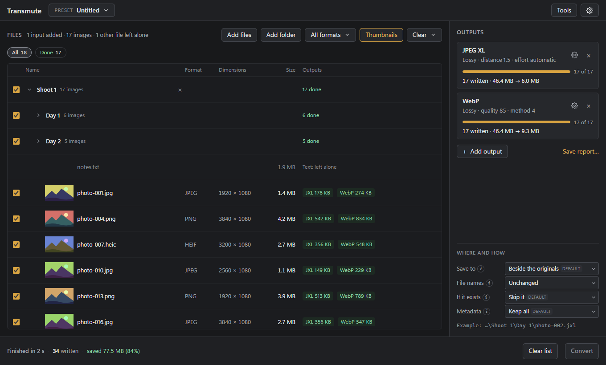
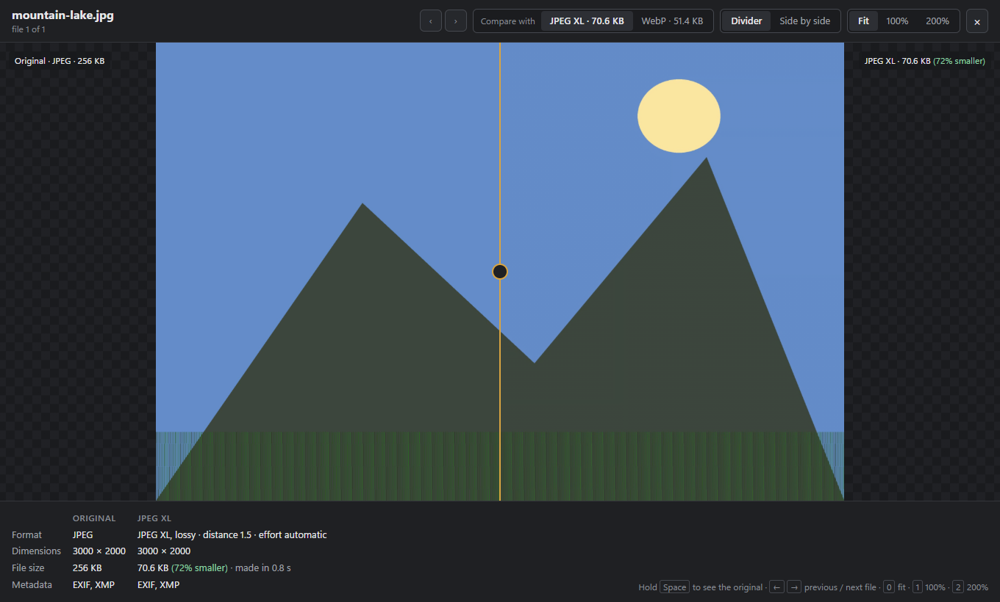
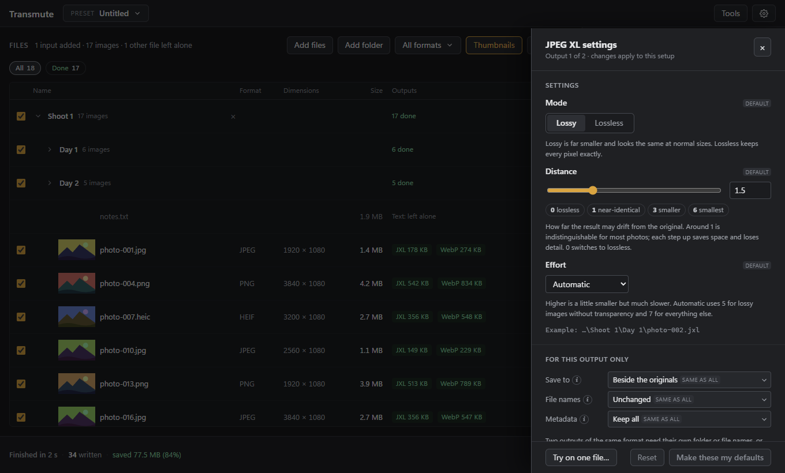

# Transmute

**A fast, approachable image converter for Windows, from a single photo to folders of tens of thousands.**

Drop in files or folders, pick the formats you want, convert. Transmute keeps your file names, never overwrites anything without asking, and shows you what each conversion did before and after. When you want more control, every format has its real encoder settings, explained in plain English.



> **Version 0.1.** A ground-up rewrite of Transmute 1.x. It converts images; video and audio aren't supported.

---

## Contents

- [Features](#features)
- [Install](#install)
- [Using Transmute](#using-transmute)
- [Formats](#formats)
- [Where things are kept](#where-things-are-kept)
- [Building from source](#building-from-source)
- [Contributing](#contributing)
- [License](#license)

---

## Features

- **Several outputs at once.** Make JPEG XL, WebP and AVIF copies of the same files in one go, each with its own settings, folder and file names.
- **Real settings, not one quality slider.** WebP quality and method, JPEG XL distance and effort, AVIF quality and effort, and so on. Defaults come from measuring size and visual quality on real photos and graphics.
- **Lossless where it pays.** WebP's *Auto* mode tries lossless on graphics (PNG, GIF, BMP, TIFF) and keeps it when it's barely larger than lossy. Photos stay lossy.
- **Safe with your files.** File names stay as they are unless you add a prefix or suffix. Name clashes are found before anything runs, and you choose what happens: skip, keep both, or replace. Originals are never replaced. Files are written to a temporary name and only moved into place when they're complete.
- **Big folders.** Folders keep their structure in a tree you can expand, filter by format, and exclude files or subfolders from. Tens of thousands of files are scanned in moments.
- **See the result.** Compare any converted file with its original, either with a divider or side by side, at 100% or 200%. *Try on one file* converts a single image so you can judge settings before running a whole batch.
- **Metadata your way.** Keep everything, keep only the copyright, keep only the colour profile, or remove it all. Location data goes when you ask it to.
- **Presets.** Save a whole setup (outputs, settings, folder, names, metadata) and load it again later, or share it as a file.
- **Damaged files are flagged.** Truncated or corrupt images are flagged before conversion, with the reason.
- **Light and dark.** Follows the Windows setting, or pick one in Settings.



## Install

Windows 10 or 11, 64-bit. Download one of these from the [releases page](../../releases):

- **`Transmute_<version>_x64-setup.exe`** installs for your user account, with a Start-menu entry and an uninstaller. It needs no administrator rights.
- **`Transmute_<version>_x64-portable.zip`**: unzip it anywhere and run `transmute.exe`. Settings stay in a `data` folder beside it, so it works from a USB stick.

The downloads aren't code-signed yet, so Windows SmartScreen may warn about them. Choose **More info → Run anyway**.

Both come with the converters for JPEG, PNG, WebP, JPEG XL, AVIF, TIFF and GIF: [libjxl](https://github.com/libjxl/libjxl), [libwebp](https://chromium.googlesource.com/webm/libwebp) and [libvips](https://www.libvips.org/). Two more tools are optional, and Transmute uses them when they're installed:

- **ImageMagick** adds HEIC/HEIF photos, BMP, and a fallback for other formats:

  ```
  winget install ImageMagick.ImageMagick
  ```

- **FFmpeg** adds another route for animations:

  ```
  winget install Gyan.FFmpeg
  ```

**Tools** in the top bar shows what each tool adds and what's missing. You can also point Transmute at a different copy of any of them there.

## Using Transmute

1. **Add images.** Drag files or folders onto the window, or use **Add files** / **Add folder**. Anything that isn't an image is listed and left alone.
2. **Pick outputs.** Choose **Add output** for each format you want. The cog on an output opens its settings; each setting says what it does.
3. **Choose where and how.** Under the outputs:
   - *Save to*: beside the originals, a subfolder per format, or a folder of your choice.
   - *File names*: unchanged, or with a prefix, a suffix, a date or a number.
   - *If it exists*: skip it, keep both, or replace it.
   - *Metadata*: keep all, copyright only, colour profile only, or remove all.
4. **Convert.** Each output's card shows its progress; the bar at the bottom shows the whole run. Failures are listed with the reason, and **Convert N left** retries them.
5. **Review.** Double-click a converted file to compare it with the original. **Save report…** writes a text report of every file.

Save a setup you'll use again with **Preset → Save as a new preset** (Ctrl+Shift+S).



## Formats

| Format | Read | Write | Notes |
|--------|:----:|:-----:|-------|
| JPEG | ✓ | ✓ | Transparent areas become a colour you choose (white by default). |
| PNG | ✓ | ✓ | |
| WebP | ✓ | ✓ | Lossy, lossless or Auto; animated GIFs stay animated. |
| JPEG XL | ✓ | ✓ | Lossless JPEG XL can repack a JPEG so the original can be restored exactly. |
| AVIF | ✓ | ✓ | |
| TIFF | ✓ | ✓ | |
| GIF | ✓ | ✓ | |
| HEIC / HEIF | ImageMagick | ImageMagick with an HEVC encoder | Phone photos. Most ImageMagick builds can read them; few can write them. |
| BMP | ImageMagick | ImageMagick | |

Transmute recognises files by their content, not their extension, so a PNG named `.jpg` is still converted correctly, and it says so.

## Where things are kept

| | Installed | Portable |
|---|---|---|
| Settings, defaults and presets | `%APPDATA%\Transmute` | `data\` beside `transmute.exe` |
| Previews, thumbnails, run journals | `%LOCALAPPDATA%\Transmute\state` | `data\state` |

The settings and preset files are plain JSON, documented in [docs/preset-format.md](docs/preset-format.md). When you uninstall, ticking **Delete the application data** removes Transmute's own files and leaves anything else in those folders, such as Transmute 1.x's settings, alone.

## Building from source

**Prerequisites:**
- [rustup](https://rustup.rs/). The pinned toolchain in `rust-toolchain.toml` installs itself.
- [Node.js](https://nodejs.org/) LTS.
- Python 3.
- On Linux, Tauri's [WebKitGTK libraries](https://v2.tauri.app/start/prerequisites/).

To convert files during development, the converters must be on `PATH`. Either install them, or run `python scripts/fetch_tools.py` to fetch the bundled set and add `target/bundle-tools/tools` to `PATH`.

```sh
npm install                    # once
npm run tauri dev              # the app, with live reload
npm run dev                    # the frontend alone in a browser, against a mock backend
npm run package                # Windows installer and portable zip, with the bundled tools

cargo test --workspace         # all Rust tests
cargo lint                     # clippy, as CI runs it
npm run lint && npm run typecheck && npm test && npm run build   # the frontend checks CI runs
TRANSMUTE_REAL_TOOLS=1 cargo test --workspace                    # also test against the installed converters
```

The backend is a Rust workspace; the desktop app is a [Tauri 2](https://v2.tauri.app/) shell with a React and TypeScript frontend.

| Part | What it does |
|------|--------------|
| `crates/transmute-core` | File detection, settings and preset formats, the job planner, and naming and collision rules. It starts no processes. |
| `crates/transmute-backends` | Finding the converters, probing what each can do, and building their command lines. |
| `crates/transmute-engine` | Running conversions in parallel, cancelling them cleanly, and moving finished files into place safely. |
| `crates/transmute-api` | The interface the app talks to: commands, events and generated TypeScript types ([docs/api.md](docs/api.md)). |
| `crates/transmute-cli` | `transmute-dev`, a developer CLI for driving the backend (`cargo dev --help`). |
| `src-tauri/` | The desktop shell. It passes commands through and holds no logic. |
| `src/` | The frontend. |

Releases: pushing a `v*` tag runs `.github/workflows/release.yml`, which builds both downloads on Windows and attaches them to a draft GitHub release.

## Contributing

1. Open an issue describing the bug or the idea.
2. Create a branch from `main`, e.g. `feat/output-targets` or `fix/collision-check`.
3. Use [Conventional Commits](https://www.conventionalcommits.org/) for commit messages.
4. Open a pull request using the template, with the checks above passing.

## License

Transmute is MIT licensed; see [LICENSE](LICENSE). The bundled converters keep their own licences, included with every download in `tools\licenses`:
- libjxl and libwebp: BSD.
- libvips: LGPL 2.1 or later.
